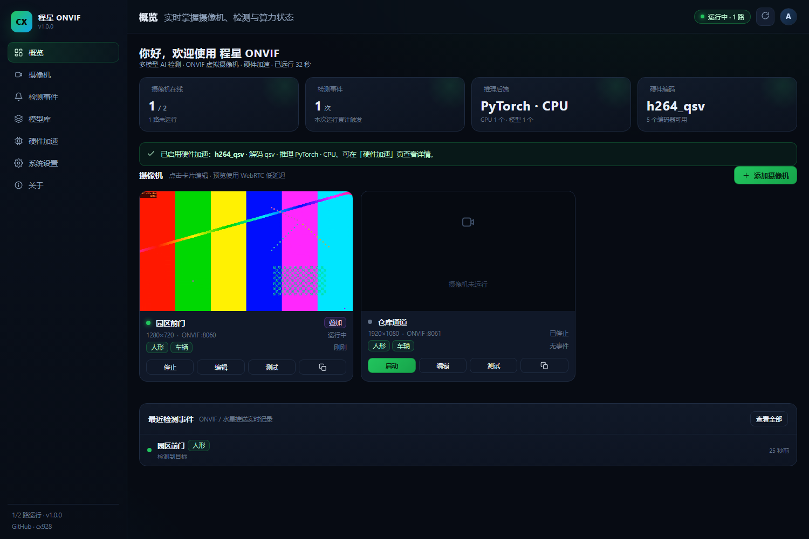
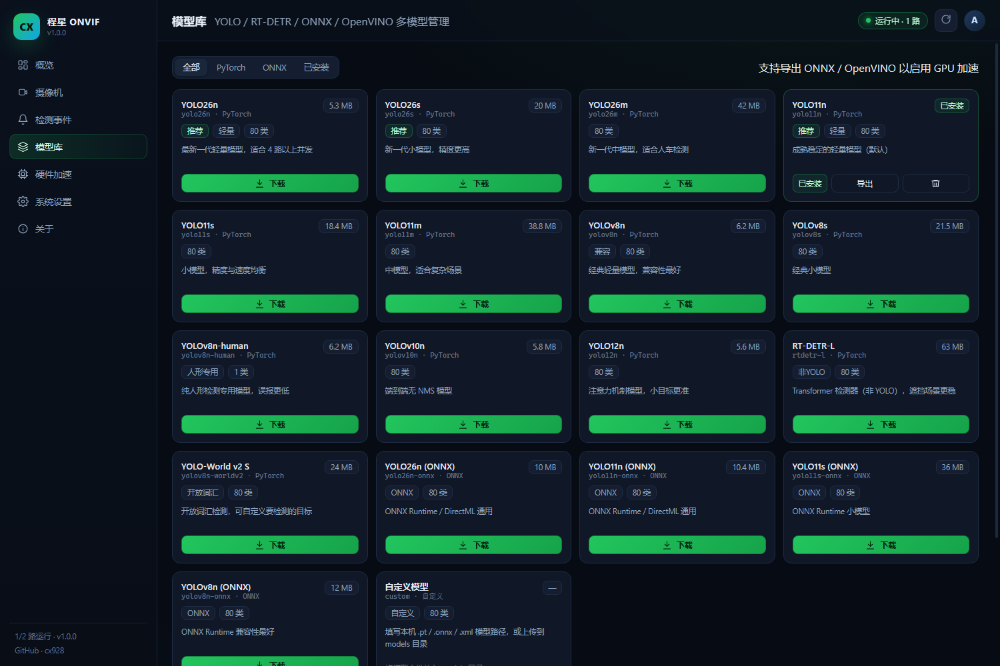
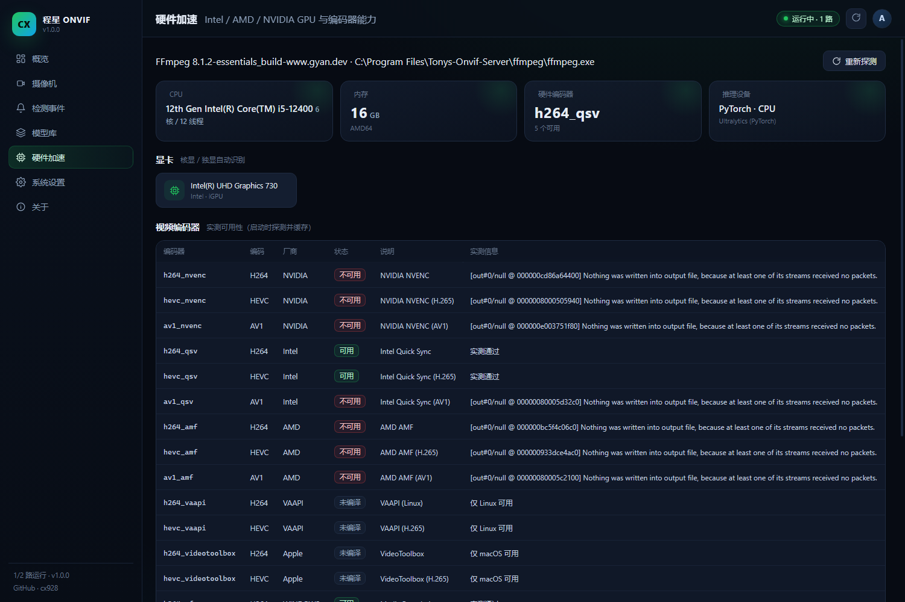
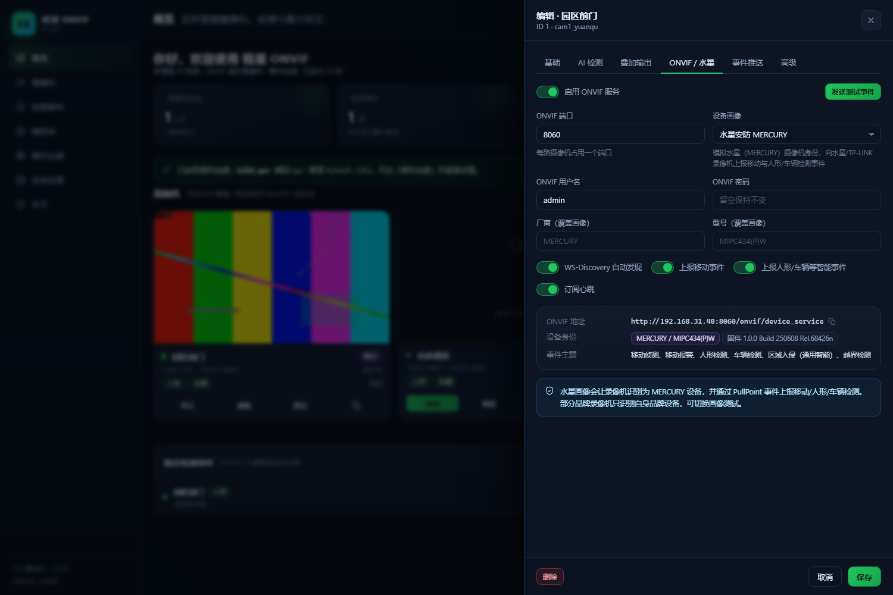

# 程星 ONVIF · ChengXing ONVIF

> 把任意 RTSP 摄像头变成 **支持多模型 AI 检测的 ONVIF 虚拟摄像机**，检测框实时叠加进视频流，并以水星安防（MERCURY）设备身份把检测事件上报给录像机。

[](LICENSE)
[](https://www.python.org/)
[]()
[]()



---

## 下载安装

| 方式 | 适用 | 文件 |
| --- | --- | --- |
| **MSI 安装包** | Windows 10/11 x64，推荐 | [ChengXing-ONVIF-1.0.0-x64.msi](https://github.com/cx928/chengxing-onvif/releases/download/v1.0.0/ChengXing-ONVIF-1.0.0-x64.msi)（212 MB） |
| **便携 ZIP** | 免安装、U 盘携带 | [ChengXing-ONVIF-1.0.0-portable-win-x64.zip](https://github.com/cx928/chengxing-onvif/releases/download/v1.0.0/ChengXing-ONVIF-1.0.0-portable-win-x64.zip)（255 MB） |
| **源码** | 开发 / 自定义 | `git clone` + `install.ps1` |

全部版本见 [Releases](https://github.com/cx928/chengxing-onvif/releases)，校验值见 [SHA256SUMS.txt](https://github.com/cx928/chengxing-onvif/releases/download/v1.0.0/SHA256SUMS.txt)。

安装包已内置：**Python 3.12 运行时、FFmpeg、MediaMTX、ONNX Runtime、YOLO11n ONNX 模型、WinUI 3 桌面控制台**，
无需单独安装 Python 或配置环境；默认以 ONNX 推理，装好即可检测人形/车辆。
需要 `.pt` 模型（YOLO26/11/8、RT-DETR、YOLO-World）时，运行包内的「安装 AI 组件」即可。

* MSI 安装到 `C:\Program Files\ChengXing ONVIF`，数据在 `C:\ProgramData\ChengXingOnvif`
* 开始菜单：启动 / 桌面控制台 / 静默启动 / 使用说明 / 卸载
* 安装后默认登录自启；可在「系统设置 → 开机自启」改为开机级静默启动
* 便携版解压后双击「启动程星 ONVIF.vbs」

构建方法见 [packaging/README.md](packaging/README.md)。

---

## 为什么是程星 ONVIF

大多数「RTSP 转 ONVIF」工具只做协议转换，录像机看到的仍然是一路“哑”视频；而 AI 检测工具又往往只支持 YOLO、只会在网页里画框，无法把结构化事件交给 NVR。

程星 ONVIF 把这三件事做在了一起：

| 痛点 | 程星 ONVIF 的做法 |
| --- | --- |
| 只支持 YOLO | 内置 **YOLO26 / YOLO11 / YOLOv8 / YOLOv10 / YOLO12 / RT-DETR / YOLO-World**，并支持任意 **ONNX / OpenVINO** 检测模型，后端可插拔 |
| 检测结果进不了录像机 | 以 **MERCURY（水星安防）设备画像** 向 NVR 上报 ONVIF 移动/人形/车辆事件，兼容标准 PullPoint 订阅，也可 HTTP 主动推送 |
| 网页能看到框，NVR 看不到 | **检测框直接烧录进视频**，输出独立叠加 RTSP 流（`<摄像机>_overlay`），任何 NVR 都能录像 |
| 多路检测吃满 CPU | 运动门控 + 硬件编码（Intel QSV / NVIDIA NVENC / AMD AMF）+ OpenVINO / CUDA / DirectML 推理，自动探测可用加速 |
| 部署麻烦、开机要手动点 | 一条命令安装，**Windows 计划任务 / systemd / launchd 开机静默自启**，无窗口、无需登录 |
| 只有一个网页版 | **纯网页版** 与 **WinUI 3 本地控制台** 两个版本，同一内核，按需选择 |

---

## 功能总览

### 1. 多模型 AI 检测（不止 YOLO）

* PyTorch 系：YOLO26 / YOLO11 / YOLOv8 / YOLOv10 / YOLO12 / RT-DETR / YOLO-World
* ONNX Runtime：任意 YOLO 风格 ONNX，支持 CPU / CUDA / TensorRT / **DirectML** / OpenVINO Execution Provider
* Intel OpenVINO：IR（`.xml`）与 ONNX，核显 / 独显 / NPU 原生加速
* 自定义模型：放入 `data/models/` 即被识别
* 目标分组统一映射为 **人形 / 车辆 / 动物 / 物品**，直接对应 NVR 的智能事件
* 运动门控、目标跟踪、区域规则（包含 / 排除）、按目标过滤、事件冷却



### 2. 水星安防（MERCURY）事件模拟

* 设备画像：`Manufacturer=MERCURY`、型号 `MIPC434(P)W`、固件、序列号、硬件 ID、URI 作用域（Scope）
* WS-Discovery 自动发现，录像机“添加设备”即可找到
* ONVIF 事件：移动（`CellMotionDetector/Motion`）、人形（`PeopleDetector`）、车辆、区域入侵、越界等
* 支持 `GetEventProperties` 动态主题集与 PullPoint 订阅，事件字段包含 Source / Rule / Data
* 提供画面内事件推送：通用 JSON、大华风格、海康 XML、水星/TP-LINK 报警推送、表单 POST

> 不同品牌 NVR 对第三方摄像机智能事件的识别能力差异很大。可在「ONVIF / 水星」页切换画像
> （MERCURY / TP-LINK VIGI / 海康 / 大华 / 宇视 / UniFi）或自定义事件主题。

### 3. 检测框叠加输出

* 一路解码同时供检测与叠加，避免重复拉流
* 检测框、中文标签、置信度、时间戳、自定义文字、检测区域实时绘制
* 独立 RTSP 路径：`rtsp://<主机>:8554/<路径>_overlay`
* 编码器：`h264_qsv` / `h264_nvenc` / `h264_amf` / `h264_vaapi` / `h264_videotoolbox` / `libx264`，失败自动降级

### 4. 硬件加速

| 硬件 | 推荐编码器 | 推荐推理后端 |
| --- | --- | --- |
| Intel 核显（UHD / Iris Xe） | `h264_qsv` | OpenVINO `GPU` |
| Intel 独显（Arc） | `h264_qsv` | OpenVINO `GPU` / ONNX DirectML |
| NVIDIA（GTX / RTX） | `h264_nvenc` | ONNX Runtime CUDA / TensorRT |
| AMD（Radeon） | `h264_amf`（Windows）/ `h264_vaapi`（Linux） | ONNX DirectML / ROCm |
| Apple Silicon | `h264_videotoolbox` | CoreML（PyTorch MPS） |
| 无独显 | `libx264` | CPU（ONNX Runtime / PyTorch） |

启动时会对每个编码器做 2 帧实测并缓存；「硬件加速」页可查看探测结果、驱动与推荐项。



### 5. 开机静默自启

* **Windows**：计划任务（SYSTEM，开机即启动，无控制台窗口），非管理员时回退到当前用户启动文件夹
* **Linux**：systemd 服务
* **macOS**：launchd
* 静默模式日志写入 `logs/cxonvif.log`

### 6. 两个版本

| 版本 | 适用场景 | 说明 |
| --- | --- | --- |
| **纯网页版** | NAS / 服务器 / 长期运行 | 浏览器打开即用，所有配置在网页完成 |
| **WinUI 3 桌面版** | Windows 本机 | 启动/停止服务、修改密码、开机自启、打开网页控制台 |

桌面版说明见 [docs/DESKTOP.md](docs/DESKTOP.md)。

---

## 快速开始

### Windows（一键安装）

```powershell
git clone https://github.com/cx928/chengxing-onvif.git
cd chengxing-onvif
powershell -ExecutionPolicy Bypass -File .\install.ps1 -WithAI -InstallAutostart
```

脚本会自动：创建 `.venv`、安装依赖、下载 FFmpeg 与 MediaMTX、安装开机自启。
完成后运行：

```powershell
.\start.ps1
```

打开 <http://localhost:5552>，默认账号 `admin` / `cx123456`（首次登录强制改密）。

### Linux / macOS

```bash
git clone https://github.com/cx928/chengxing-onvif.git
cd chengxing-onvif
chmod +x install.sh
sudo ./install.sh --with-ai --service
```

```bash
./start.sh
```

### Docker（纯网页版）

```bash
git clone https://github.com/cx928/chengxing-onvif.git
cd chengxing-onvif
docker compose up -d --build
```

访问 <http://localhost:5552>。数据保存在 `./data`。
Linux 上若需要 WebRTC 与 ONVIF 组播发现，建议在 compose 中使用 `network_mode: host`。

### 手动安装

```bash
python -m venv .venv
# Windows
.venv\Scripts\python -m pip install -r requirements.txt opencv-python-headless
# Linux / macOS
.venv/bin/python -m pip install -r requirements.txt opencv-python-headless

python -m cxonvif serve
```

前置条件：Python 3.10+、FFmpeg（可放 `vendor/ffmpeg` 或 PATH）、MediaMTX（自动下载或放 `vendor/mediamtx`）。

---

## 添加第一路摄像机

1. 打开控制台 → **摄像机 → 添加摄像机**
2. 填入主码流地址，例如：
   * 海康：`rtsp://admin:密码@192.168.1.64:554/Streaming/Channels/101`
   * 大华：`rtsp://admin:密码@192.168.1.65:554/cam/realmonitor?channel=1&subtype=0`
   * 水星 / TP-LINK：`rtsp://admin:密码@192.168.1.66:554/stream1`
3. 点击「探测」自动回填分辨率，选择检测模型与目标，保存
4. 在 **ONVIF / 水星** 页设置 ONVIF 端口（默认自动分配）与密码
5. 在录像机中添加 ONVIF 设备：
   * IP：本机局域网 IP
   * 端口：该摄像机的 ONVIF 端口（如 `8001`）
   * 用户名 / 密码：摄像机页设置的值
   * 或使用 WS-Discovery 直接搜索



### 接入录像机的三种方式

| 方式 | 地址 | 用途 |
| --- | --- | --- |
| ONVIF | `http://<IP>:<ONVIF端口>/onvif/device_service` | 完整设备接入 + 事件 |
| 原始 RTSP | `rtsp://<IP>:8554/<路径>_main` | 只录像，不依赖 ONVIF |
| 叠加 RTSP | `rtsp://<IP>:8554/<路径>_overlay` | 带检测框的录像画面 |

---

## 水星安防事件上报

1. 摄像机 → **ONVIF / 水星** → 设备画像选择 **水星安防 MERCURY**
2. 打开「上报移动事件」「上报人形/车辆等智能事件」
3. 保存后，在录像机中订阅事件（多数 NVR 会自动订阅 PullPoint）
4. 点击「发送测试事件」验证

支持的事件主题（可按画像自动匹配，也可在配置中覆盖）：

| 主题 | 数据项 | 含义 |
| --- | --- | --- |
| `tns1:RuleEngine/CellMotionDetector/Motion` | `IsMotion` | 移动侦测 |
| `tns1:VideoSource/MotionAlarm` | `State` | 移动报警 |
| `tns1:RuleEngine/PeopleDetector/PeopleDetected` | `State` | 人形检测 |
| `tns1:RuleEngine/VehicleDetector/VehicleDetected` | `State` | 车辆检测 |
| `tns1:RuleEngine/FieldDetector/ObjectsInside` | `IsInside` | 区域入侵 |
| `tns1:RuleEngine/LineDetector/Crossed` | `Crossed` | 越界检测 |
| `tns1:RuleEngine/CrossLineDetector/Crossed` | `Crossed` | 越界（大华风格） |

HTTP 主动推送（部分 NVR / 平台不支持 ONVIF 订阅时使用）见
[docs/MERCURY.md](docs/MERCURY.md)。

---

## 模型

内置模型可在「模型库」一键下载；已下载的 `.pt` 模型可一键导出 ONNX / OpenVINO：

| 模型 | 类型 | 说明 |
| --- | --- | --- |
| YOLO26n/s/m | PyTorch | 最新一代，端到端无 NMS |
| YOLO11n/s/m | PyTorch | 稳定通用（默认） |
| YOLOv8n/s、YOLOv8n-human | PyTorch | 兼容性最好 / 纯人形专用 |
| YOLOv10n、YOLO12n | PyTorch | 无 NMS / 注意力机制 |
| RT-DETR-L | PyTorch | Transformer 检测器（非 YOLO） |
| YOLO-World v2 S | PyTorch | 开放词汇检测 |
| YOLO26n / 11n / 11s / v8n ONNX | ONNX | 官方预导出，免本机转换 |
| 自定义 | `.pt` / `.onnx` / `.xml` | 放入 `data/models/` |

详细说明：[docs/MODELS.md](docs/MODELS.md)。

> YOLO 官方权重与 `ultralytics` 采用 **AGPL-3.0**，商业闭源分发需遵守其许可或购买企业授权。
> 也可以使用自训练的 ONNX/OpenVINO 模型规避。

---

## 目录结构

```
cxonvif/            引擎（ONVIF、检测、叠加、MediaMTX、API）
  hw/               硬件探测与编码参数
  detect/           模型、后端、跟踪、区域、叠加、管线
  stream/           帧源、MediaMTX、叠加推流
  onvif/            设备/媒体/事件服务、厂商画像
  emulate/          水星安防模拟、报警推送
  api/              REST API v2
  core/             摄像机、管理器、自启、运行时
web/                纯网页控制台（原生 ES Module，无构建步骤）
desktop/            WinUI 3 桌面控制台
docs/               使用与开发文档
tests/              单元测试
install.*           安装脚本
```

数据目录默认：

* Windows：`C:\ProgramData\ChengXingOnvif`
* Linux：`/var/lib/chengxing-onvif`（root）或 `~/.local/share/chengxing-onvif`
* macOS：`~/Library/Application Support/ChengXingOnvif`

可用环境变量 `CXONVIF_HOME` 覆盖。目录内含 `config.json`、`models/`、`snapshots/`、`logs/`。

---

## 常用命令

```bash
python -m cxonvif serve                 # 前台启动（Web 版）
python -m cxonvif serve --silent        # 静默启动（自启使用）
python -m cxonvif doctor                # 环境与硬件自检
python -m cxonvif autostart install     # 安装开机自启
python -m cxonvif autostart status
python -m cxonvif password 新密码
python -m cxonvif models list
python -m cxonvif models download yolo11n
python -m cxonvif probe rtsp://...
```

---

## 常见问题

**网页预览黑屏？**
H.265 编码在多数浏览器无法直接播放。请在摄像机后台改为 H.264，或在摄像机「高级」中开启转码。
NVR 录像不受此影响。

**NVR 搜索不到设备？**
确认防火墙放行 Web 端口、RTSP 端口、ONVIF 端口（8001+）与 UDP 3702；虚拟机需开启混杂模式；
也可在 NVR 中手动填写 `IP:ONVIF端口`。

**叠加流打不开？**
确认摄像机运行且「叠加输出」已开启；`rtsp://127.0.0.1:8554/<路径>_overlay` 可用 ffplay 测试；
若硬件编码器不可用会自动切换 libx264，可在「硬件加速」页查看原因。

**检测太慢 / 占用高？**
降低检测频率（3–5 FPS）、缩小分析宽度、开启运动门控、使用 GPU 推理；叠加输出使用硬件编码。

**开机自启没有生效？**
以管理员身份重新运行 `python -m cxonvif autostart install`；`autostart status` 查看计划任务状态。

更多：[docs/TROUBLESHOOTING.md](docs/TROUBLESHOOTING.md)。

---

## 文档

* [快速上手](docs/QUICKSTART.md)
* [水星安防事件模拟](docs/MERCURY.md)
* [模型与推理后端](docs/MODELS.md)
* [硬件加速](docs/ACCELERATION.md)
* [桌面版（WinUI 3）](docs/DESKTOP.md)
* [REST API](docs/API.md)
* [架构说明](docs/ARCHITECTURE.md)
* [常见问题](docs/TROUBLESHOOTING.md)

---

## 联系作者

* **B 站**：<https://space.bilibili.com/1765875510>
* **GitHub**：<https://github.com/cx928>
* **邮箱**：<wanghaotian@cxdx.edu.kg>
* **项目仓库**：<https://github.com/cx928/chengxing-onvif>

如果这个项目帮到了你，欢迎在 B 站三连或在 GitHub 点一个 Star ⭐。

---

## 许可

本项目以 [MIT](LICENSE) 协议开源。第三方组件与致谢见 [NOTICE](NOTICE)。
请遵守当地法律法规，仅将本软件用于合法的安防与视频分析场景。
